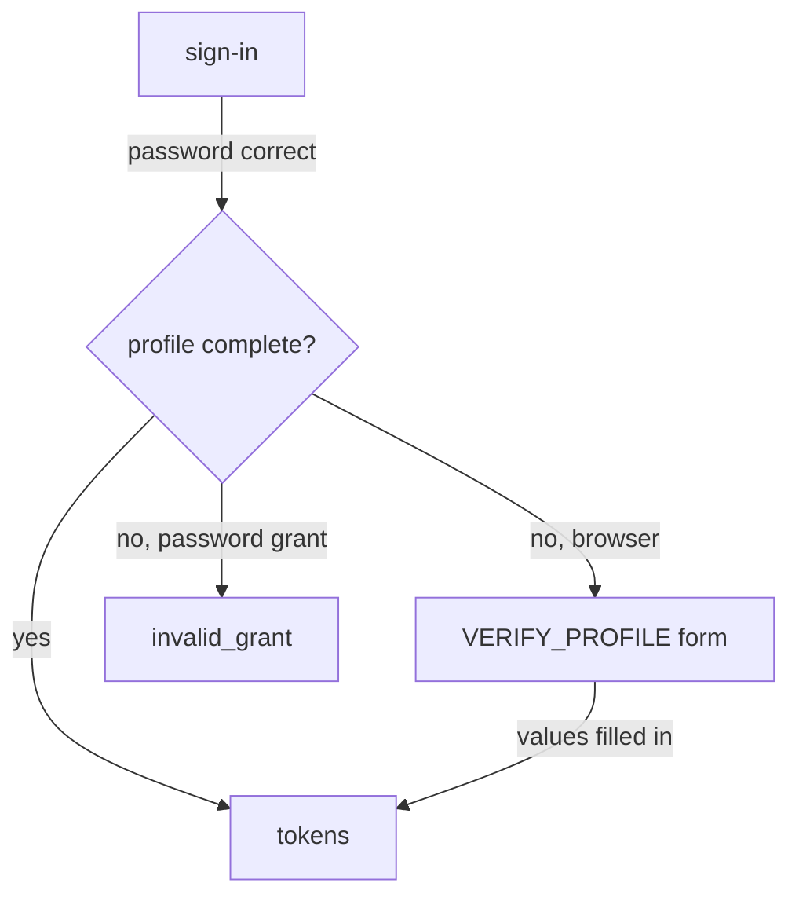

# Users And The Declarative User Profile

Before you can fix a user, you need to know what Keycloak expects a user to look like. That expectation is not fixed in code. Each realm keeps its own list of user attributes and the rules for each one. This part shows you that list, the **user profile**, and why it decides whether an administrator can create a user and whether the user can finish signing in.

## What a user is made of

A user record has a few built-in fields and any number of attributes. The built-in fields are the username, the email address, the first name, the last name, and the flags `enabled` and `emailVerified`. An **attribute** is a named value stored on the user, for example a department or a phone number. Credentials, such as a password, are stored apart from the record and are never shown in it.

Start by reading one user. First paste the helper below. `kcadm` runs `kcadm.sh`, Keycloak's administration command-line tool, inside the Keycloak pod; every command it runs is a call to the Admin REST API, the HTTP API the Admin Console also uses. The last line signs it in to the `master` realm as the lab-only administrator:

<!-- astrona:playground:renew -->

```sh
NAMESPACE=users-demo
kcadm() {
  kubectl -n "$NAMESPACE" exec -i deploy/keycloak -- \
    /opt/keycloak/bin/kcadm.sh "$@" --config /tmp/kcadm.config
}
kcadm config credentials --server http://localhost:8080 --realm master --user admin --password admin
```

Now read `alice` in the realm `inventory`. The query `-q username=alice -q exact=true` asks for an exact match, not a search:

```sh
kcadm get users -r inventory -q username=alice -q exact=true
```

The result is a JSON list with one user. It holds `id`, a generated identifier that never changes, plus `username`, `firstName`, `lastName`, `email`, `emailVerified`, `enabled` and `requiredActions`. Keycloak finds a user by `id` in every other command, so you will copy it often. The password is not in the output.

## The user profile

The **user profile** is the realm's list of user attributes. For each attribute it says who may see it, who may edit it, which checks the value must pass, and whether it is required. Keycloak calls it *declarative* because you describe the rules as data, and Keycloak applies them everywhere: in the Admin Console, the Admin REST API, the account console and the sign-in pages.

Read the profile of the realm `inventory`. It lives at `users/profile` in the Admin REST API. The `jq` filter keeps only the name of each attribute and its `required` rule:

```sh
kcadm get users/profile -r inventory | jq '.attributes[] | {name, required}'
```

You get four attributes: `username`, `email`, `firstName` and `lastName`. `username` has no `required` rule because Keycloak always requires it. The other three have a `required` rule that lists the role `user`. That means the user must provide the value; an administrator who creates or edits the record does not have to. A rule that also lists `admin` would bind administrators too.

The four default attributes are the start, not the limit. An administrator can add attributes, for example `department`, and make them required, read-only for the user, or visible only to administrators. Attributes that are not in the profile are *unmanaged*, and by default Keycloak does not let anyone set them.

## Who a required rule applies to

Because the rule names only the role `user`, an administrator can create a user with nothing but a username. Create one, and give it a password so it can try to sign in:

```sh
kcadm create users -r inventory -s username=testuser -s enabled=true
kcadm set-password -r inventory --username testuser --new-password testuser-password
```

`kcadm.sh` prints that it created a new user and shows its `id`, and the password is set without complaint. The record now has no email, no first name and no last name. Keycloak accepted it, because the administrator was not bound by the rule. The user is, and that matters at the next sign-in.

## What "required" does to a user

A record can end up without a required value in several ways: an administrator created it with only a username, the profile changed after the user was created, or the user came from somewhere else, such as an LDAP directory. Keycloak does not delete such a user. Instead, at the next sign-in, the required action `VERIFY_PROFILE` asks the user to fill in the missing values.

A **required action** is a task a user must finish at sign-in before Keycloak issues tokens. In a browser, Keycloak shows a form. A client that uses the password grant has no form to show, so the token endpoint refuses the request instead. You will see that refusal for yourself in the lab.



The diagram shows what Keycloak does after the password check: a complete profile gets tokens, and an incomplete one gets a form in a browser or an error on the password grant.

You now know where a realm keeps its rules for users, and that a required attribute binds the roles its rule names, by default only the user. The next question is about the other half of signing in: the password, and the tasks Keycloak can attach to it.

## Common pitfalls

> [!WARNING]
> - **Searching instead of matching.** `kcadm get users -q username=al` returns every user whose name contains `al`. Add `-q exact=true` when a script needs exactly one user.
> - **Turning off a required rule to let one user in.** Removing a `required` rule changes it for every user in the realm. Fill in the missing value on that one user instead.
> - **Creating users with only a username.** Keycloak accepts it, but the user cannot finish signing in until the profile is complete. Fill in email, first name and last name when you create the user.
> - **Looking for the password in the user record.** Credentials are stored apart from the record. Read them with `users/<id>/credentials`, which shows the type, never the value.
> - **Setting an attribute the profile does not know.** Unmanaged attributes are refused by default. Add the attribute to the user profile first.
