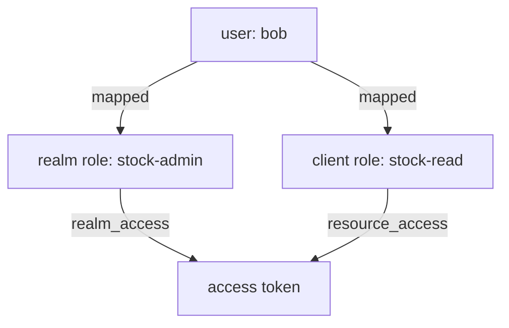

# Realm Roles And Client Roles

An API needs a simple yes or no: may this caller change stock? Keycloak answers with roles. Before you can combine roles or give them to groups, you need to know the two places a role can live, and how a role on one user reaches that user's token. This part covers realm roles, client roles and direct role mappings.

## Two kinds of role

A **realm role** is defined once for the whole realm. Any client can see it, so it suits a job title that means the same everywhere, such as `warehouse-clerk` or `stock-admin`. A **client role** is defined by one client and belongs to it. It suits a permission that only one API understands, such as `stock-write` on `inventory-api`. Two APIs can each have a `read` client role without clashing.

Paste the helpers for this part. `kcadm` runs Keycloak's administration command-line tool inside the Keycloak pod. `get_access_token` asks the realm `inventory` for a token with the password grant from the `tester` pod and prints only the access token; OAuth 2.1 drops the password grant, and a real application uses the authorization code flow. `decode_token` reads a JWT on standard input and prints its claims as JSON:

<!-- astrona:playground:renew -->

```sh
NAMESPACE=roles-demo
kcadm() {
  kubectl -n "$NAMESPACE" exec -i deploy/keycloak -- \
    /opt/keycloak/bin/kcadm.sh "$@" --config /tmp/kcadm.config
}
get_access_token() {
  kubectl -n "$NAMESPACE" exec deploy/tester -- curl -s \
    http://keycloak:8080/realms/inventory/protocol/openid-connect/token \
    -d grant_type=password -d client_id=inventory-cli -d username="$1" -d password="$2" \
    | jq -r .access_token
}
decode_token() {
  jq -R 'split(".")[1] | gsub("-";"+") | gsub("_";"/") | . + ("=" * ((4 - length % 4) % 4)) | @base64d | fromjson'
}
kcadm config credentials --server http://localhost:8080 --realm master --user admin --password admin
```

List the realm roles of `inventory`, then the client roles of `inventory-api`. A client role is reached through the client's internal `id`, so the second command looks it up first:

```sh
kcadm get roles -r inventory --fields name,composite
API_ID="$(kcadm get clients -r inventory -q clientId=inventory-api --fields id --format csv --noquotes | tr -d '\r')"
kcadm get "clients/$API_ID/roles" -r inventory --fields name
```

The realm roles are the ones every realm starts with: `offline_access`, `uma_authorization` and `default-roles-inventory`, which is marked `composite`. The client roles of `inventory-api` are `stock-read` and `stock-write`.

## Creating a realm role and mapping it to a user

Create a realm role for administrators of the stock, and give it to `bob` directly. `kcadm.sh add-roles` is a shortcut that finds the user and the role by name; `--uusername` names the user and `--rolename` the role:

```sh
kcadm create roles -r inventory -s name=stock-admin -s 'description=Administers the stock'
kcadm add-roles -r inventory --uusername bob --rolename stock-admin
kcadm get-roles -r inventory --uusername bob
```

The last command lists the realm roles mapped to `bob` directly: `default-roles-inventory`, which every user gets, and `stock-admin`, which you just added. A **role mapping** is this link between a user (or a group) and a role.

## Mapping a client role

A client role is mapped the same way, with `--cclientid` naming the client that owns it. Give `bob` the right to read stock:

```sh
kcadm add-roles -r inventory --uusername bob --cclientid inventory-api --rolename stock-read
kcadm get-roles -r inventory --uusername bob --cclientid inventory-api
```

The second command lists `stock-read`, the only role of `inventory-api` mapped to `bob`.

## Reading roles in the token

The mappings mean nothing to an API until they are in the token. Get an access token for `bob` and look at two claims:

```sh
get_access_token bob bob-password | decode_token | jq '{realm_access, resource_access}'
```

`realm_access.roles` lists the realm roles, including `stock-admin` and the roles that `default-roles-inventory` contains. `resource_access` has one entry per client whose roles `bob` holds; under `inventory-api` you find `roles` with `stock-read`, and under `account` the roles that let `bob` use his account console.



The diagram shows the two kinds of mapping and the two claims they end up in: realm roles in `realm_access`, client roles in `resource_access` under the client's ID.

You can now create both kinds of role, map them to a user, and find them in the token. Mapping roles one by one to every user does not scale, though; the open question is how to bundle roles together.

## Common pitfalls

> [!WARNING]
> - **Looking for a client role in `realm_access`.** Client roles are in `resource_access`, under the client ID that owns them.
> - **Using a realm role for one API's permission.** Every client sees realm roles, so a generic name such as `write` soon means different things to different APIs. Use a client role.
> - **Forgetting `--cclientid`.** Without it, `add-roles` looks for a realm role of that name and fails.
> - **Expecting a new mapping in an old token.** A token holds the roles from the moment it was issued. Request a new token after every change.
