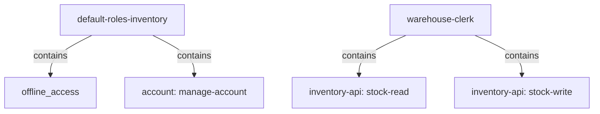

# Composite Roles And Default Roles

A warehouse clerk needs to read stock and change stock. Mapping both client roles to every clerk works, but the day the clerks also need a third role, you have to touch every user again. A composite role solves this by bundling roles under one name. Keycloak also uses one composite role to give every user a starting set of roles. This part covers both.

## Building a composite role

A **composite role** is a role that contains other roles. A user mapped to it gets every role it contains, and every role those contain in turn. A composite can contain realm roles and client roles.

Paste the helpers for this part. `kcadm` runs Keycloak's administration command-line tool inside the Keycloak pod. `get_access_token` asks the realm `inventory` for a token with the password grant from the `tester` pod and prints only the access token; OAuth 2.1 drops the password grant, and a real application uses the authorization code flow. `decode_token` reads a JWT on standard input and prints its claims as JSON:

<!-- astrona:playground:renew -->

```sh
NAMESPACE=roles-demo
kcadm() {
  kubectl -n "$NAMESPACE" exec -i deploy/keycloak -- \
    /opt/keycloak/bin/kcadm.sh "$@" --config /tmp/kcadm.config
}
get_access_token() {
  kubectl -n "$NAMESPACE" exec deploy/tester -- curl -s \
    http://keycloak:8080/realms/inventory/protocol/openid-connect/token \
    -d grant_type=password -d client_id=inventory-cli -d username="$1" -d password="$2" \
    | jq -r .access_token
}
decode_token() {
  jq -R 'split(".")[1] | gsub("-";"+") | gsub("_";"/") | . + ("=" * ((4 - length % 4) % 4)) | @base64d | fromjson'
}
kcadm config credentials --server http://localhost:8080 --realm master --user admin --password admin
```

Create the realm role `warehouse-clerk` and add both client roles of `inventory-api` to it. With `--rname`, `add-roles` adds roles to a role instead of to a user:

```sh
kcadm create roles -r inventory -s name=warehouse-clerk -s 'description=Warehouse staff: read and change stock'
kcadm add-roles -r inventory --rname warehouse-clerk --cclientid inventory-api   --rolename stock-read --rolename stock-write
kcadm get roles/warehouse-clerk/composites -r inventory --fields name,clientRole
```

The last command lists `stock-read` and `stock-write`, both with `clientRole` set to `true`. Reading the role itself with `kcadm get roles/warehouse-clerk -r inventory` now shows `composite` as `true`.

## Composite roles in the token

Map the composite to `alice`, and read her token:

```sh
kcadm add-roles -r inventory --uusername alice --rolename warehouse-clerk
get_access_token alice alice-password | decode_token | jq '{realm_access, resource_access}'
```

`realm_access.roles` contains `warehouse-clerk`, and `resource_access` has an entry for `inventory-api` with `stock-read` and `stock-write`, although neither is mapped to `alice` directly. Keycloak expands every composite when it builds the token, so the API only ever sees the final list.

Remove the direct mapping again before you continue. Mapping roles straight to users is what the next part replaces with groups:

```sh
kcadm remove-roles -r inventory --uusername alice --rolename warehouse-clerk
```

## Default roles

Every realm has one composite role named `default-roles-<realm>`, here `default-roles-inventory`. Keycloak maps it to every user, new and existing. Its contents are the roles every user of the realm should have. Read them:

```sh
kcadm get roles/default-roles-inventory/composites -r inventory --fields name,clientRole
```

You get `offline_access` and `uma_authorization`, plus the client roles `view-profile` and `manage-account` of the client `account`, which let users manage their own account. Because every user is mapped to `default-roles-inventory`, a role you add to it reaches every user at their next token, and a role you remove disappears for everyone. The Admin Console shows the same list under **Realm settings**, **User registration**, **Default roles**.



The diagram shows two composite roles and what they contain; a user mapped to the top box of either one gets everything below it.

You now know how to bundle roles under one name and how a realm gives every user a starting set. A composite still has to be mapped to each user, though. The open question is how to map it once for a whole team.

## Common pitfalls

> [!WARNING]
> - **Adding a sensitive role to the default roles.** `default-roles-<realm>` reaches every user, including existing ones. Give such roles to a group instead.
> - **Removing `manage-account` from the default roles by accident.** Users can then no longer manage their own account.
> - **Building deep chains of composites.** Each level is expanded into every token. Keep composites flat enough that you can still say why a user has a role.
> - **Expecting the composite's name alone in the token.** The API receives the composite and every role inside it; check for the role the API really needs.
