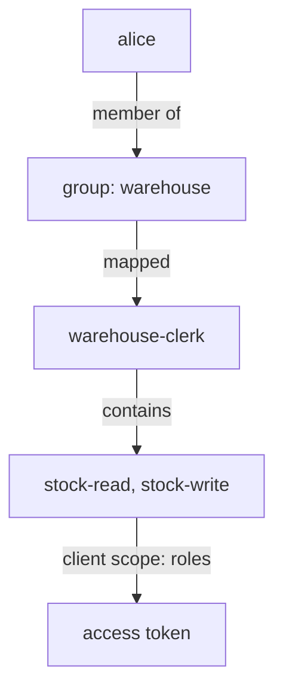

# Group Role Mappings And Roles In Tokens

A team of twenty clerks should all get `warehouse-clerk`, and a new clerk should get it the moment they join the team. Groups make that one mapping instead of twenty. But even a correct mapping is only half the story: the client that requests the token decides, through its client scopes, whether the roles are written into the token at all. This part covers both halves.

## Mapping roles to a group

Roles mapped to a **group** apply to every member of the group, and to every member of its subgroups. So the access of a user is the sum of their own mappings and the mappings of every group they are in, including the parents of those groups.

Paste the helpers for this part. `kcadm` runs Keycloak's administration command-line tool inside the Keycloak pod. `get_access_token` asks the realm `inventory` for a token with the password grant from the `tester` pod and prints only the access token; OAuth 2.1 drops the password grant, and a real application uses the authorization code flow. `decode_token` reads a JWT on standard input and prints its claims as JSON:

<!-- astrona:playground:renew -->

```sh
NAMESPACE=roles-demo
kcadm() {
  kubectl -n "$NAMESPACE" exec -i deploy/keycloak -- \
    /opt/keycloak/bin/kcadm.sh "$@" --config /tmp/kcadm.config
}
get_access_token() {
  kubectl -n "$NAMESPACE" exec deploy/tester -- curl -s \
    http://keycloak:8080/realms/inventory/protocol/openid-connect/token \
    -d grant_type=password -d client_id=inventory-cli -d username="$1" -d password="$2" \
    | jq -r .access_token
}
decode_token() {
  jq -R 'split(".")[1] | gsub("-";"+") | gsub("_";"/") | . + ("=" * ((4 - length % 4) % 4)) | @base64d | fromjson'
}
kcadm config credentials --server http://localhost:8080 --realm master --user admin --password admin
```

Create the group `warehouse`, map the composite role `warehouse-clerk` to it, and add `alice`. With `--gname`, `add-roles` maps a role to a group. The role `warehouse-clerk` must exist; create it first if this playground does not have it yet:

```sh
kcadm get roles/warehouse-clerk -r inventory >/dev/null 2>&1 || {
  kcadm create roles -r inventory -s name=warehouse-clerk
  kcadm add-roles -r inventory --rname warehouse-clerk --cclientid inventory-api     --rolename stock-read --rolename stock-write
}
kcadm create groups -r inventory -s name=warehouse
kcadm add-roles -r inventory --gname warehouse --rolename warehouse-clerk
```

Membership is the path `users/<user id>/groups/<group id>`. Look up both IDs and link them:

```sh
ALICE_ID="$(kcadm get users -r inventory -q username=alice -q exact=true --fields id --format csv --noquotes | tr -d '\r')"
GROUP_ID="$(kcadm get groups -r inventory -q search=warehouse --fields id,name --format csv --noquotes | tr -d '\r' | awk -F, '$2 == "warehouse" {print $1}')"
kcadm update "users/$ALICE_ID/groups/$GROUP_ID" -r inventory -s realm=inventory -s userId="$ALICE_ID" -s groupId="$GROUP_ID" -n
```

## Direct mappings and effective roles

Now compare what is mapped to `alice` herself with what she really holds. `get-roles` shows direct mappings by default, and every role she holds with `--effective`:

```sh
kcadm get-roles -r inventory --uusername alice
kcadm get-roles -r inventory --uusername alice --effective
```

The first list holds only `default-roles-inventory`: nothing else is mapped to `alice` directly. The second list holds `warehouse-clerk` too, plus the roles inside the composites. When someone asks "why does this user have this role?", the difference between the two lists is the answer: it came from a group or a composite.

## How roles get into the token: the client scope roles

A **client scope** is a named set of protocol mappers and role settings that a client can include in its tokens. A **protocol mapper** is a rule that writes one claim into a token. Every new client gets a few default client scopes, and one of them, `roles`, holds the mappers that write `realm_access` and `resource_access`. Without it, the token has no roles at all, whatever the user holds.

List the default client scopes of `inventory-cli`:

```sh
CLI_ID="$(kcadm get clients -r inventory -q clientId=inventory-cli --fields id --format csv --noquotes | tr -d '\r')"
kcadm get "clients/$CLI_ID/default-client-scopes" -r inventory --fields name
```

The list includes `roles`, next to scopes such as `profile`, `email`, `basic` and `web-origins`. Now read the roles in a fresh token for `alice`:

```sh
get_access_token alice alice-password | decode_token | jq '{realm_access, resource_access}'
```

`realm_access.roles` contains `warehouse-clerk`, and `resource_access.inventory-api.roles` contains `stock-read` and `stock-write`. They came from the group, through the composite, and into the token through the client scope `roles`.



The diagram shows the whole chain from user to token; a break at any arrow removes the roles from the token.

One more setting can filter roles. Each client has **Full scope allowed**, on by default. When it is on, every role the user holds can enter the token. When it is off, only the roles listed in the client's scope mappings can. Leave it on in this module, and remember it when a role is mapped correctly but still missing.

You can now give a whole team its roles with one group mapping, explain where each role of a user comes from, and check that the client lets the roles into the token. That is the full chain an API depends on.

## Your mission: Give A Group The Roles Its Members Need

You can now build a composite role, map it to a group, and prove the result in a token. The graded lab gives you a realm with only the API's client roles, and asks you to build the role model for the warehouse team so that `alice` gets exactly the right roles through her group.

The lab runs in its own cluster, so first pause your playground. Nothing in it is lost:

```sh
astrona stop ats-089-playground-020-01
```

Then start the lab:

```sh
astrona run --git ssh://git@github.com/astrona-io/ATS089.git -c sections/section-020/module-01/labs/lab-01
```

The task is on the next page. Solve it on your own first. When you think you are done, send it for grading:

```sh
astrona submit -c sections/section-020/module-01/labs/lab-01
```

When the lab is done, remove it and start your playground again:

```sh
astrona destroy ats-089-lab-020-01
astrona start ats-089-playground-020-01
```

## Common pitfalls

> [!WARNING]
> - **Mapping roles to users "just this once".** Direct mappings outlive the reason for them. Map to a group, so removing a user from the group removes the access.
> - **Reading only direct mappings.** A user can hold a role through a group or a composite. Use `get-roles --effective`.
> - **Removing the client scope `roles` from a client.** Every token of that client loses `realm_access` and `resource_access`, and every API that checks roles refuses the calls.
> - **Turning off Full scope allowed without scope mappings.** The client's tokens then carry no roles at all until you add scope mappings.
