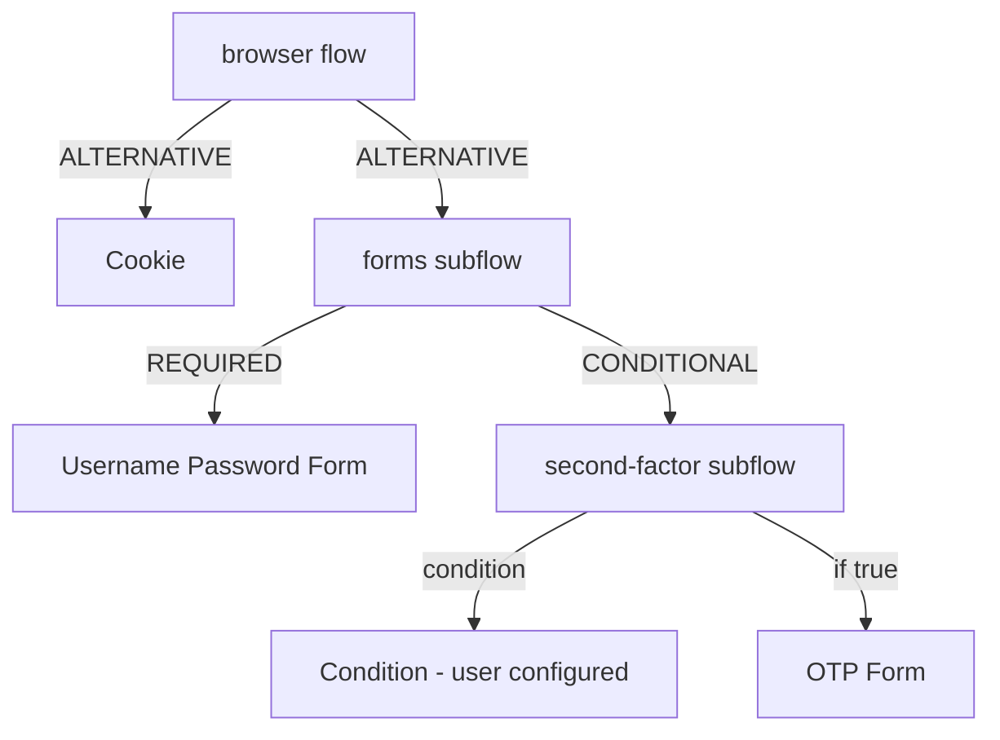

# Authentication Flows, Executions And Requirements

Every change to how users sign in, from a stronger password to a security key, is a change to an authentication flow. Before you change one, you need to read one: which steps it has, which must succeed, and which flow the realm actually uses for a browser or a terminal client. This part reads the built-in flows and explains how they are bound to the realm.

## The flows a realm has

An **authentication flow** is an ordered tree of steps that Keycloak runs when a user signs in. Every realm starts with a set of built-in flows, one per job: `browser` for sign-ins in a web browser, `direct grant` for the password grant, `registration` for new users, `reset credentials` for a forgotten password, `clients` for client authentication, and `first broker login` for users who arrive from another identity provider.

Paste the helper for this part. `kcadm` runs Keycloak's administration command-line tool inside the Keycloak pod. The last line signs it in to the `master` realm as the lab-only administrator:

<!-- astrona:playground:renew -->

```sh
NAMESPACE=flows-demo
kcadm() {
  kubectl -n "$NAMESPACE" exec -i deploy/keycloak -- \
    /opt/keycloak/bin/kcadm.sh "$@" --config /tmp/kcadm.config
}
kcadm config credentials --server http://localhost:8080 --realm master --user admin --password admin
```

List the top-level flows of `inventory`:

```sh
kcadm get authentication/flows -r inventory --fields alias,builtIn,topLevel
```

Each flow in the list has `builtIn` set to `true`. Keycloak does not let you change the executions of a built-in flow, which protects the default behaviour. To change a flow, you copy it.

## Executions and requirements

An **execution** is one step in a flow: an authenticator (a form or a check), a condition, or a subflow that holds more executions. Read the executions of the `browser` flow. `level` shows how deep each step sits in the tree:

```sh
kcadm get authentication/flows/browser/executions -r inventory \
  --fields displayName,providerId,requirement,level,authenticationFlow
```

At level `0` you see the cookie check, the Kerberos step, the identity provider redirector and a subflow for the forms. Inside the forms subflow, at level `1`, are the username and password form and a subflow for a second factor. That subflow has the requirement `CONDITIONAL`, and inside it, at level `2`, are a condition such as `Condition - user configured` and authenticators such as the OTP form.

The **requirement** of an execution decides what happens to it:

| Requirement | What Keycloak does |
| --- | --- |
| `REQUIRED` | The step must succeed. If it fails, the sign-in fails |
| `ALTERNATIVE` | At least one of the alternatives at the same level must succeed |
| `CONDITIONAL` | Only for subflows: the subflow runs only when all of its conditions are true |
| `DISABLED` | The step is skipped |

In the browser flow, the cookie, the identity provider redirector and the forms subflow are alternatives: a valid cookie ends the sign-in at once, and only without one do the forms run. The second-factor subflow is conditional: its condition `Condition - user configured` is true only when the user has set up a credential for the authenticator, so a user without an OTP device is not asked for a code.



The diagram shows the main path of the browser flow: a cookie or the forms, and inside the forms a password and a conditional second factor.

## Bindings: which flow the realm uses

A flow does nothing until it is **bound**: a realm setting names the flow Keycloak runs for each kind of request. Read the bindings:

```sh
kcadm get realms/inventory --fields browserFlow,directGrantFlow,registrationFlow,resetCredentialsFlow,clientAuthenticationFlow,firstBrokerLoginFlow
```

`browserFlow` is `browser` and `directGrantFlow` is `direct grant`. The two are separate, which matters later: a second factor added to the browser flow does not change the password grant, because the password grant runs the `direct grant` flow. A single client can also override a binding for itself, but realm bindings are the normal place.

## Copying a flow

To change the browser flow, copy it and change the copy. The copy keeps every execution and its requirement:

```sh
kcadm create authentication/flows/browser/copy -r inventory -s newName=browser-copy
kcadm get authentication/flows/browser-copy/executions -r inventory --fields displayName,requirement,level
```

The second command lists the same executions as the original. The subflows in the copy get new names that start with the new flow's name; read them from the `displayName` field instead of guessing. The copy is not bound yet, so nothing has changed for users. Only `kcadm update realms/inventory -s browserFlow=browser-copy` would put it in use.

You can now read any flow, explain each requirement, and find the flow a realm really runs. The open question is what to change in a copy to make sign-ins stronger, which is where password policies and one-time passwords come in.

## Common pitfalls

> [!WARNING]
> - **Binding a half-finished flow.** Users meet every step of a bound flow at once. Finish and check the copy, then bind it.
> - **Expecting the password grant to follow the browser flow.** It runs the `direct grant` flow. Change that flow separately if you mean to.
> - **Guessing subflow names in a copy.** Read them from `displayName` in the executions list.
> - **Making every step `REQUIRED`.** Alternatives such as the cookie then stop working, and users must type their password on every visit.
