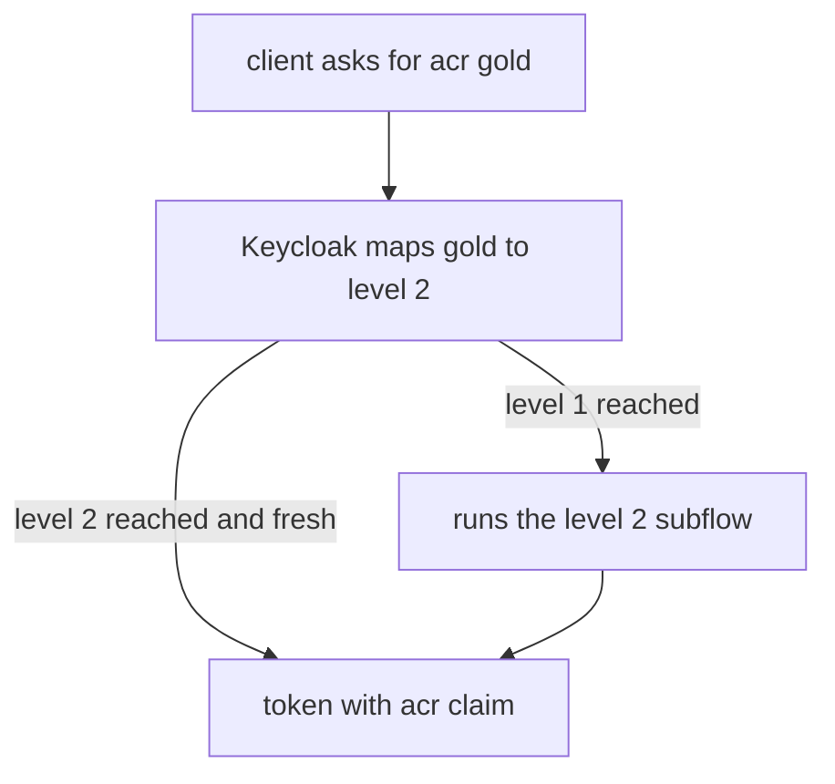

# Step-Up Authentication

A user signed in with a password can read their orders. The same user should show a second factor before they change a payment setting. Asking for the second factor on every sign-in is annoying, and never asking is risky. **Step-up authentication** asks for a stronger proof only when the application needs it. This part explains how Keycloak measures the strength of a sign-in and how a client asks for more.

## Levels of authentication

Keycloak describes the strength of a sign-in with a **level of authentication**, written LoA, a number such as 1 or 2. The browser flow is built from subflows, and each subflow can carry the condition **Condition - Level of Authentication**. The condition has two settings: the **Level of Authentication** that the subflow provides, for example 2 for the subflow that asks for a one-time password, and the **Max Age**, the number of seconds the proof stays valid. A Max Age of 0 asks again at every request for that level.

A client does not ask for a number. It asks for a name, called an **ACR** value (authentication context class reference), such as `silver` or `gold`. The realm maps names to levels with the realm attribute `acr.loa.map`, a JSON object. A client can set its own `acr.loa.map` to override the realm's.

## Mapping names to levels

Paste the helper. The attribute value is a JSON text, so it is passed as a quoted string:

<!-- astrona:playground:renew -->

```sh
NAMESPACE=flows-demo
kcadm() {
  kubectl -n "$NAMESPACE" exec -i deploy/keycloak -- \
    /opt/keycloak/bin/kcadm.sh "$@" --config /tmp/kcadm.config
}
kcadm config credentials --server http://localhost:8080 --realm master --user admin --password admin
kcadm update realms/inventory -s 'attributes."acr.loa.map"="{\"silver\":1,\"gold\":2}"'
kcadm get realms/inventory --fields attributes
```

The read shows `acr.loa.map` with the two names. Now the name `gold` means level 2 for every client of the realm.

## How a client asks for a level

An OpenID Connect client sends the wanted ACR in the authorization request. The simple way is the `acr_values` parameter, for example `acr_values=gold`. The precise way is the `claims` parameter, which can mark the value as essential:

```text
claims={"id_token":{"acr":{"essential":true,"values":["gold"]}}}
```

If the user's current sign-in is only at level 1, Keycloak runs the subflow with level 2 and asks for the one-time password. If the user already proved level 2 and it is not older than the Max Age, Keycloak does not ask again. The ID token then carries the claim `acr` with the level the user reached, so the application can check it before it allows the sensitive action. Always check the claim in the application, because a client can send any `acr_values`.

A client can also have a default ACR value and a minimum, so every request from it needs at least that level without sending the parameter.



The diagram shows that Keycloak asks for the extra proof only when the reached level is lower than the requested one.

## What you can test from the terminal

The browser flow needs a browser, so this module checks the configuration, not the prompt. Read the map back, and read the flow to see the conditions:

```sh
kcadm get authentication/flows -r inventory --fields alias,builtIn
kcadm get realms/inventory --fields browserFlow
```

Build the level 2 subflow in the Admin Console: add a conditional subflow to a copy of the browser flow, add the condition with level 2 and Max Age, and add the OTP form with the requirement Required.

## Common pitfalls

> [!WARNING]
> - **Writing the map as an object instead of a string.** The attribute value is JSON text.
> - **Trusting `acr_values` alone.** The application must check the `acr` claim of the token.
> - **A Max Age of 0 by mistake.** Users are asked at every request for that level.
> - **Editing the built-in browser flow.** Copy it, change the copy and bind it.
