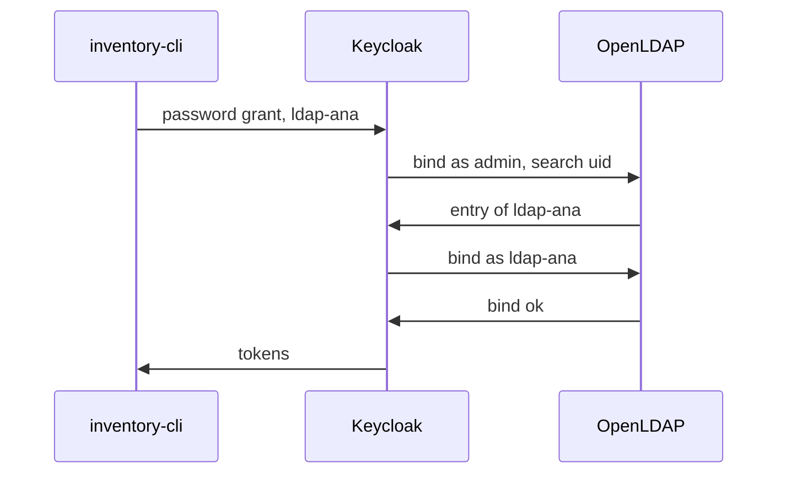

# LDAP Federation And The User Storage SPI

Before Keycloak can read a directory, you have to tell it where the users are and how they are named. LDAP has its own vocabulary for that, and every setting of the LDAP provider uses it. This part reads the OpenLDAP directory directly, explains the words you need, and shows how Keycloak plugs a directory in.

## How an LDAP directory is organised

An LDAP directory is a tree of **entries**. Each entry has a **distinguished name (DN)**, which is its full path in the tree written from the entry up to the top, for example `uid=ldap-ana,ou=people,dc=example,dc=org`. Each part of a DN is an attribute and a value: `uid` is a user ID, `ou` an organisational unit (a folder), and `dc` a domain component. The **base DN** is the top of the tree, here `dc=example,dc=org`.

To read the directory, a client first **binds**: it signs in to the LDAP server with a DN and a password. Keycloak binds with a service account to search for users, and it binds as the user to check that user's password.

Paste the helper for this part. `ldap_search` runs `ldapsearch`, the LDAP command-line search tool, inside the OpenLDAP pod, bound as the directory's lab-only administrator:

<!-- astrona:playground:renew -->

```sh
NAMESPACE=ldap-demo
ldap_search() {
  kubectl -n "$NAMESPACE" exec deploy/openldap -- ldapsearch -x -LLL -H ldap://localhost \
    -D cn=admin,dc=example,dc=org -w ldap-admin-password -b "$1" "${2:-(objectClass=*)}"
}
```

Read the entry of `ldap-ana`:

```sh
ldap_search ou=people,dc=example,dc=org '(uid=ldap-ana)'
```

The output starts with `dn: uid=ldap-ana,ou=people,dc=example,dc=org`, followed by the entry's attributes: the object classes `inetOrgPerson`, `organizationalPerson` and `person`, then `uid`, `cn`, `givenName`, `sn` (surname), `mail` and `userPassword`. The object classes say which attributes the entry may have. The administrator can read `userPassword`; Keycloak never needs to, because it checks a password by binding as the user.

Now read the groups:

```sh
ldap_search ou=groups,dc=example,dc=org
```

The group `cn=warehouse,ou=groups,dc=example,dc=org` has the object class `groupOfNames` and one `member` attribute, holding the DN of `ldap-ana`. A group in LDAP stores its members as a list of DNs.

## What the LDAP provider needs to know

Those two searches contain everything the LDAP provider in Keycloak asks for:

| Setting | Value here | What it is |
| --- | --- | --- |
| Connection URL | `ldap://openldap:389` | Where the LDAP server answers |
| Bind DN / bind credential | `cn=admin,dc=example,dc=org` / `ldap-admin-password` | The account Keycloak binds with to search |
| Users DN | `ou=people,dc=example,dc=org` | The folder that holds the users |
| Username LDAP attribute | `uid` | The attribute that holds the username |
| RDN LDAP attribute | `uid` | The first part of a user's DN |
| UUID LDAP attribute | `entryUUID` | An attribute that never changes, used to link the Keycloak user to the entry |
| User object classes | `inetOrgPerson, organizationalPerson` | The object classes of a user entry |

## The User Storage SPI

Keycloak is built from providers that implement **service provider interfaces (SPIs)**: Java interfaces that let a module add a feature without changing Keycloak itself. The **User Storage SPI** is the interface for user stores outside Keycloak's database. A provider that implements it can look users up, check their credentials and, if it wants, list and change them.

The LDAP provider is one implementation of the User Storage SPI that ships with Keycloak. The same interface lets a developer connect a custom store, such as an old SQL user table, by writing a provider in Java. Writing one is a development topic; what matters here is that every federation provider, LDAP or custom, appears in the realm as a **component**, the Admin REST API object that holds a provider's settings, and in the Admin Console under **User federation**.



The diagram shows a federated sign-in: Keycloak finds the user with its own bind, then checks the password by binding as the user, and only then issues tokens.

With **import** on, the default, Keycloak also keeps a copy of each LDAP user in its own database, linked to the entry by the UUID attribute. The copy lets Keycloak store data LDAP has no place for, such as required actions, and the link keeps the directory in charge. Every imported user carries a `federationLink` field with the ID of the provider it came from.

You now know how an LDAP directory names its users, which settings the LDAP provider needs, and how the provider fits into Keycloak. The open question is how to create it and prove that a directory user can sign in.

## Common pitfalls

> [!WARNING]
> - **Writing a DN from the top down.** A DN is written from the entry up: `uid=ldap-ana,ou=people,dc=example,dc=org`, never `dc=org,...`.
> - **Using a changing attribute as the UUID attribute.** If the link attribute changes, Keycloak loses the connection to the entry. Use one that never changes, such as `entryUUID` in OpenLDAP or `objectGUID` in Active Directory.
> - **Binding with a personal account.** Keycloak's bind account should be a service account with read access to the users DN, so it does not break when a person leaves.
> - **Reading `userPassword` to compare passwords.** Keycloak checks a password by binding as the user; it never needs to read the stored value.
