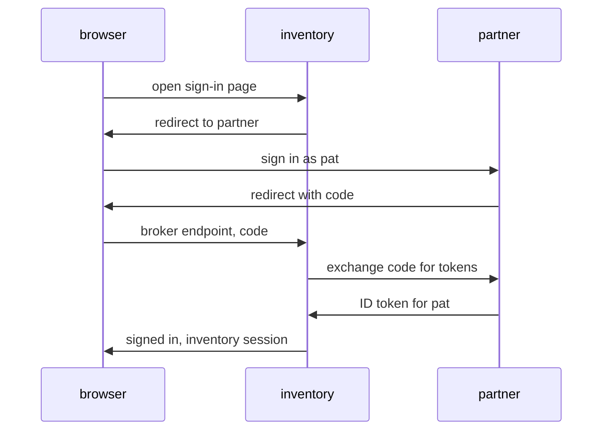

# Identity Brokering And Social Login

A partner employee clicks a button on the inventory sign-in page and ends up signed in, without the realm `inventory` ever seeing their password. Several redirects, a code exchange and a signed token make that happen. This part follows those steps, explains what Keycloak does with the user it receives, and shows where social login fits in.

## The brokered sign-in, step by step

In a brokered sign-in, the realm `inventory` acts as a client of the realm `partner`. It uses the authorization code flow, the same flow any web application uses with Keycloak. The only difference is that the "application" is another Keycloak realm.



The diagram shows the redirects: the browser carries the user between the two realms, and the realms talk to each other only for the code exchange.

The address the browser returns to is the **broker endpoint** of the realm, `/realms/<realm>/broker/<alias>/endpoint`, where the alias is the name of the identity provider in the realm. For a provider with the alias `partner` in `inventory`, that is `/realms/inventory/broker/partner/endpoint`. The external provider must accept it as a redirect URI of the client the broker uses.

## Reading the partner realm

The broker learns where `partner`'s endpoints are from its **discovery document**, the JSON a realm publishes at `/.well-known/openid-configuration`. Read it from the `tester` pod and keep the four fields the broker needs:

<!-- astrona:playground:renew -->

```sh
NAMESPACE=broker-demo
kubectl -n "$NAMESPACE" exec deploy/tester -- curl -s \
  http://keycloak:8080/realms/partner/.well-known/openid-configuration \
  | jq '{issuer, authorization_endpoint, token_endpoint, jwks_uri}'
```

All four values start with `http://keycloak:8080/realms/partner`, because the `tester` pod asked for them at that address. In development mode, Keycloak builds its URLs from the address of the request. That matters for brokering: the browser must reach the authorization endpoint, and Keycloak must reach the token endpoint, so the broker's settings must use an address that works for both. In this playground, the browser reaches Keycloak through a port-forward at `http://localhost:8080`, and the Keycloak pod reaches its own `localhost:8080` for the token request, so `http://localhost:8080/realms/partner` works for both.

Now look at the client in `partner` that the broker will use. It is a confidential client, so `inventory` proves who it is with a client secret, and its only redirect URI is the broker endpoint:

```sh
kcadm() {
  kubectl -n "$NAMESPACE" exec -i deploy/keycloak -- \
    /opt/keycloak/bin/kcadm.sh "$@" --config /tmp/kcadm.config
}
kcadm config credentials --server http://localhost:8080 --realm master --user admin --password admin
kcadm get clients -r partner -q clientId=inventory-broker --fields clientId,publicClient,standardFlowEnabled,redirectUris
```

## What Keycloak does with the user it receives

The ID token from `partner` says who the user is, but `inventory` still needs a local user to attach sessions, roles and groups to. The first time a person arrives from an identity provider, Keycloak runs the **first broker login flow**, by default the built-in flow `first broker login`. It can ask the user to review their profile, and it checks whether a local user with the same username or email already exists. If one does, the flow asks the user to link the accounts, after proving they own the local one. From then on, the local user is linked to the identity provider, and later sign-ins skip the flow.

Each identity provider also has a **sync mode**, which decides what happens to the local user at later sign-ins:

| Sync mode | What Keycloak does with the provider's data |
| --- | --- |
| `IMPORT` | Copies the user's data at the first sign-in only |
| `FORCE` | Updates the local user from the provider at every sign-in |
| `LEGACY` | The behaviour of older versions, kept for existing setups |

**Identity provider mappers** copy or set data during a brokered sign-in. For example, one can copy a claim from the ID token into a user attribute, and another can give every brokered user a fixed role.

## Social login

Social login is identity brokering with a public provider. Keycloak has built-in provider types for GitHub, Google, Microsoft, Facebook, GitLab and others. Each one works the same way as `partner`: you register an application with the provider, which gives you a client ID and a client secret, and you register Keycloak's broker endpoint as the redirect URI. This playground has no internet access for that, so the module uses `partner` instead, with exactly the same mechanics.

You now know how a brokered sign-in moves between two identity providers, what the broker endpoint and the first broker login flow are for, and what sync modes and mappers do. The open question is how to put all of it into the realm `inventory`.

## Common pitfalls

> [!WARNING]
> - **Confusing brokering with federation.** With brokering, the other provider checks the password; with federation, Keycloak checks it against the directory.
> - **Registering the wrong redirect URI.** The external provider must allow exactly `/realms/<realm>/broker/<alias>/endpoint` of the broker; a different alias gives a different URI.
> - **Using an address the browser cannot reach.** The authorization endpoint is opened by the browser, so it must be reachable from the user's machine.
> - **Choosing `FORCE` without thinking.** Every sign-in overwrites the local user's data from the provider, including changes made in Keycloak.
