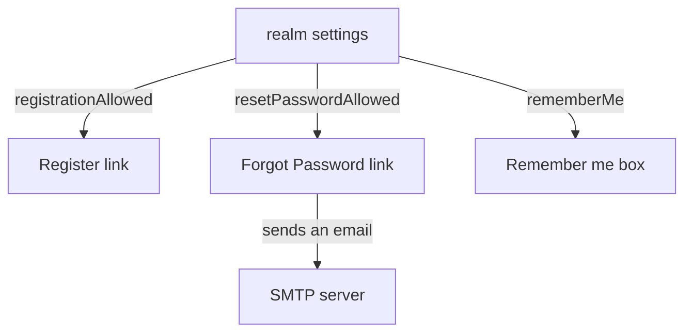

# Login Options Of A Realm

The sign-in page of a realm looks simple, but every link and checkbox on it is a switch in the realm settings. Registration, the forgotten password link and the remember me checkbox each exist only when an administrator turns them on. This part lists those switches, shows the name of each one in the Admin REST API and shows how they interact.

## The switches of the Login tab

In the Admin Console, the **Login** tab of **Realm settings** holds the sign-in options. Each one is a boolean field of the realm representation:

| Console label | Field | What it does |
| --- | --- | --- |
| User registration | `registrationAllowed` | Shows a **Register** link; a visitor can create their own user |
| Edit username | `editUsernameAllowed` | Lets a user change their username in the account console and at the profile form |
| Forgot password | `resetPasswordAllowed` | Shows a **Forgot Password?** link that starts the reset credentials flow |
| Remember me | `rememberMe` | Shows a checkbox that keeps the user signed in after the browser closes |
| Email as username | `registrationEmailAsUsername` | Hides the username field at registration and uses the email address as the username |
| Login with email | `loginWithEmailAllowed` | Lets a user sign in with the email address as well as the username |
| Duplicate emails | `duplicateEmailsAllowed` | Lets two users have the same email address |
| Verify email | `verifyEmail` | Makes every user prove their email address with the required action `VERIFY_EMAIL` |

Paste the helper and read the current values of the realm `inventory`. The `--fields` option keeps only the named fields:

<!-- astrona:playground:renew -->

```sh
NAMESPACE=realm-settings-demo
kcadm() {
  kubectl -n "$NAMESPACE" exec -i deploy/keycloak -- \
    /opt/keycloak/bin/kcadm.sh "$@" --config /tmp/kcadm.config
}
kcadm config credentials --server http://localhost:8080 --realm master --user admin --password admin
kcadm get realms/inventory --fields registrationAllowed,resetPasswordAllowed,rememberMe,loginWithEmailAllowed,duplicateEmailsAllowed,verifyEmail,editUsernameAllowed
```

A new realm has registration off, forgotten password off, remember me off, login with email on, duplicate emails off, verify email off and edit username off. The JSON shows each field with `true` or `false`.

## Changing a switch and seeing the page change

Turn on registration and forgotten password, then request the sign-in page of the client `inventory-web` from the `tester` pod and search it for the two links. The page is HTML, so `grep` finds the link targets by name:

```sh
kcadm update realms/inventory -s registrationAllowed=true -s resetPasswordAllowed=true
kubectl -n "$NAMESPACE" exec deploy/tester -- curl -s \
  'http://keycloak:8080/realms/inventory/protocol/openid-connect/auth?client_id=inventory-web&response_type=code&scope=openid&redirect_uri=http%3A%2F%2Fkeycloak%3A8080%2Fcallback' \
  | grep -o -e 'login-actions/registration' -e 'login-actions/reset-credentials' | sort -u
```

Keycloak, the server that renders the page, now includes the two links. The command prints one line for each link it finds. Set both fields back to `false` and run the request again: the lines disappear, which proves the page follows the realm setting and not a cached copy.

## How the switches interact

Some switches depend on each other. When `registrationEmailAsUsername` is on, the registration form has no username field, and `editUsernameAllowed` has no effect, because the username is the email address. When `duplicateEmailsAllowed` is on, `loginWithEmailAllowed` is turned off by Keycloak, because an email address that belongs to two users cannot identify one of them. Keycloak applies this rule when you save the realm.

The reset credentials flow has a dependency of a different kind. The forgotten password link starts a flow that sends an email, so the realm needs a working SMTP server, which is the subject of the next part. Without it, the link is shown but the user never receives the message.



The diagram shows that two of the visible options are plain switches, and that the forgotten password link depends on the email server.

You now know which realm field controls each link and checkbox of the sign-in page, and that Keycloak enforces a few combinations by itself. The next question is how a realm sends email at all.

## Common pitfalls

> [!WARNING]
> - **Turning on forgotten password without SMTP.** The link appears and the user waits for a message that never comes.
> - **Allowing duplicate emails and expecting email sign-in.** Keycloak turns `loginWithEmailAllowed` off when `duplicateEmailsAllowed` is on.
> - **Enabling registration on an internal realm.** Anyone who reaches the page can create a user. Turn it on only for a public application.
> - **Reading the setting in the wrong realm.** Every command needs `-r inventory`. Without it, `kcadm.sh` reads the `master` realm.
