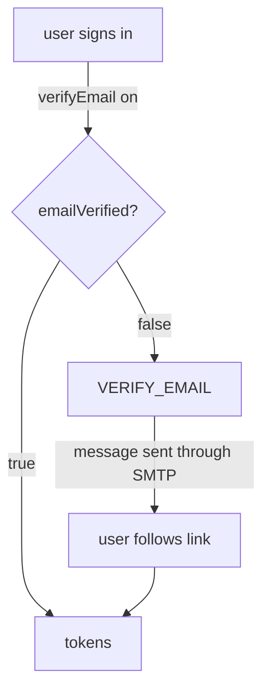

# Email Settings And Email Verification

Keycloak sends email for several jobs: to verify an address, to reset a password, to tell a user about a required action and to invite a user to an organization. All of them go through one SMTP server that you configure per realm. This part shows the fields of that configuration and what happens to users when a feature needs email and no server is set.

## The SMTP server of a realm

**SMTP** (Simple Mail Transfer Protocol) is the protocol a mail server accepts messages with. A realm stores its server settings in the field `smtpServer`, a set of named values. A realm has no SMTP server until you add one, and the `master` realm and the `inventory` realm each have their own.

The most used values are `host` and `port` (where the server listens), `from` (the sender address), `fromDisplayName` (the sender name), `replyTo`, `auth` (`true` when the server needs a login), `user` and `password` (the login), and `ssl` and `starttls` (how the connection is encrypted). All values are strings, including the port and the booleans.

Paste the helper and read the current value. A realm without a server prints nothing for `smtpServer`:

<!-- astrona:playground:renew -->

```sh
NAMESPACE=realm-settings-demo
kcadm() {
  kubectl -n "$NAMESPACE" exec -i deploy/keycloak -- \
    /opt/keycloak/bin/kcadm.sh "$@" --config /tmp/kcadm.config
}
kcadm config credentials --server http://localhost:8080 --realm master --user admin --password admin
kcadm get realms/inventory --fields smtpServer
```

Set a server. The address `mail.example.com` is a placeholder; the playground has no mail server, so Keycloak stores the values but cannot deliver a message. The dotted name `smtpServer.host` sets one value inside the field:

```sh
kcadm update realms/inventory \
  -s smtpServer.host=mail.example.com \
  -s smtpServer.port=25 \
  -s smtpServer.from=noreply@inventory.example.com \
  -s smtpServer.fromDisplayName="Inventory Support" \
  -s smtpServer.auth=false
kcadm get realms/inventory --fields smtpServer
```

The result lists the five values you set. If you set `auth=true`, you also set `smtpServer.user` and `smtpServer.password`. Keycloak never shows the stored password again: the read prints `**********` in its place.

## Email verification

The realm field `verifyEmail` makes Keycloak ask each user to prove that they own their address. When it is on, a user whose `emailVerified` is `false` gets the required action `VERIFY_EMAIL` at the next sign-in. Keycloak sends a message with a link and holds the user at the sign-in page until the user follows the link. A user whose `emailVerified` is already `true` is not asked.

This is the part that surprises administrators. If `verifyEmail` is on and the realm has no working SMTP server, every user with an unverified address is stuck, because the message never arrives. A user who uses the password grant gets the same `invalid_grant` refusal as with any other pending required action.

Test it on a user. The command creates `unverified` with a password and `emailVerified=false`, turns `verifyEmail` on and reads the user's state:

```sh
kcadm create users -r inventory -s username=unverified -s enabled=true \
  -s email=unverified@example.com -s emailVerified=false \
  -s firstName=Un -s lastName=Verified
kcadm set-password -r inventory --username unverified --new-password unverified-password
kcadm update realms/inventory -s verifyEmail=true
kcadm get users -r inventory -q username=unverified -q exact=true --fields username,emailVerified,requiredActions
```

The user record shows `emailVerified` as `false`. At the next browser sign-in Keycloak requires `VERIFY_EMAIL` and tries to send the message. A client that uses the password grant is refused instead, because it has no page to show. As an administrator you can unblock a user without email: set `emailVerified=true` on the user.

```sh
kcadm update "users/$(kcadm get users -r inventory -q username=unverified -q exact=true --fields id --format csv --noquotes | tr -d '\r')" -r inventory -s emailVerified=true
```

Turn `verifyEmail` back off at the end so the realm stays usable: `kcadm update realms/inventory -s verifyEmail=false`.



The diagram shows that a user with an unverified address reaches a token only through the email link, which needs the SMTP server.

You now know where a realm keeps its email server and how verification depends on it. The remaining visible settings are the language and the look of the pages Keycloak shows.

## Common pitfalls

> [!WARNING]
> - **Turning on `verifyEmail` before configuring SMTP.** Users with an unverified address cannot finish a sign-in.
> - **Using numbers and booleans in `smtpServer`.** The values are strings. `port=25` is sent as text and that is correct.
> - **Putting the SMTP password in a script you share.** Use a secret store; the password is shown to anyone who reads the script.
> - **Replacing the whole `smtpServer` value.** Setting `-s smtpServer={...}` replaces every value in it. Use `smtpServer.<name>` to change one.
