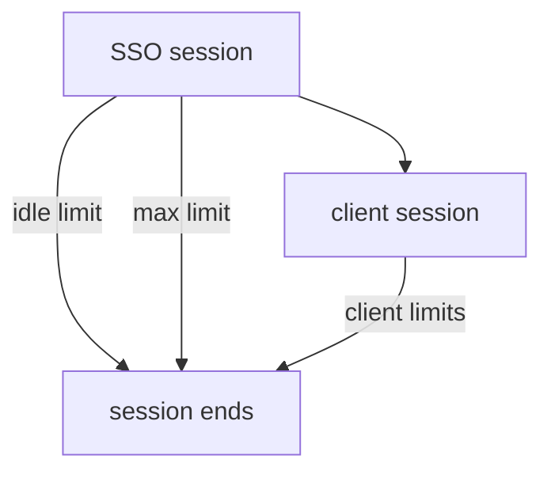

# SSO Session Settings

When a user signs in, Keycloak creates a session and, in a browser, sets a cookie that points to it. As long as the session lives, the user can sign in to other applications of the realm without typing a password again. That behavior is called single sign-on (SSO). This part explains the limits that end a session and shows where to read and change them.

## Idle time and maximum time

Two limits end an SSO session. The **SSO Session Idle** limit ends the session when the user has not used it for that long. The **SSO Session Max** limit ends it after that long no matter how active the user is. Both are stored on the realm in seconds.

| Console label | Realm field | Default |
| --- | --- | --- |
| SSO Session Idle | `ssoSessionIdleTimeout` | 1800 (30 minutes) |
| SSO Session Max | `ssoSessionMaxLifespan` | 36000 (10 hours) |
| SSO Session Idle Remember Me | `ssoSessionIdleTimeoutRememberMe` | 0 (use the idle value) |
| SSO Session Max Remember Me | `ssoSessionMaxLifespanRememberMe` | 0 (use the max value) |

Paste the helper and read the fields of the realm `inventory`:

<!-- astrona:playground:renew -->

```sh
NAMESPACE=sessions-demo
kcadm() {
  kubectl -n "$NAMESPACE" exec -i deploy/keycloak -- \
    /opt/keycloak/bin/kcadm.sh "$@" --config /tmp/kcadm.config
}
kcadm config credentials --server http://localhost:8080 --realm master --user admin --password admin
kcadm get realms/inventory --fields ssoSessionIdleTimeout,ssoSessionMaxLifespan,ssoSessionIdleTimeoutRememberMe,ssoSessionMaxLifespanRememberMe
```

The read prints the four values. An activity that refreshes the session is a sign-in, a token refresh or a request to the user info endpoint with a valid token. Each such request moves the idle clock back to zero, while the maximum clock never moves.

## Changing the limits

Set the idle limit to 15 minutes and the maximum to 8 hours. Keycloak requires the idle value to be no larger than the maximum:

```sh
kcadm update realms/inventory -s ssoSessionIdleTimeout=900 -s ssoSessionMaxLifespan=28800
kcadm get realms/inventory --fields ssoSessionIdleTimeout,ssoSessionMaxLifespan
```

The new limits apply to new sessions and also to existing ones, because Keycloak checks the limits each time it uses a session. A session that was created before the change and has already been idle for 20 minutes ends at the next use.

## Remember me

When the realm option `rememberMe` is on and the user ticks the checkbox, Keycloak uses the remember me limits instead of the normal ones. Setting `ssoSessionIdleTimeoutRememberMe` to 604800 keeps such a session for a week of idle time. A value of 0 means the normal limits apply, as the table shows.

## Client session limits

A realm can also limit the client session, the part of an SSO session that belongs to one application. `clientSessionIdleTimeout` and `clientSessionMaxLifespan` default to 0, which means the SSO limits apply. If you set a value, it works inside the SSO limits, because a client session belongs to an SSO session.



The diagram shows that the SSO session ends at its idle or maximum limit, and that each client session lives inside it with its own optional limits.

You now know the four limits that decide how long a user stays signed in. A session limit does not decide how long one token works, which is the next topic.

## Common pitfalls

> [!WARNING]
> - **Setting idle larger than max.** Keycloak refuses the update. The idle limit must not exceed the maximum.
> - **Counting seconds as minutes.** Every value is in seconds. `900` is 15 minutes.
> - **Expecting a change to wait for the next sign-in.** The limits also apply to sessions that already exist.
> - **Forgetting remember me.** A user who ticks the box gets the remember me limits, not the normal ones.
