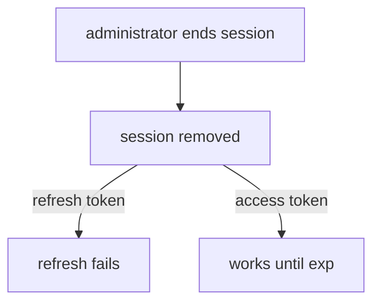

# Administering Sessions

When a laptop is lost or a user leaves, an administrator needs to see who is signed in and end the sessions. When a security team asks how many users are active, an administrator needs a count. This part shows the Admin REST API calls for listing, counting and ending sessions and explains what ending a session does not do.

## Listing and counting

The Admin REST API can list sessions from three sides: of one user, of one client and as a count per client for the whole realm. First create some sessions with the password grant, then list them:

<!-- astrona:playground:renew -->

```sh
NAMESPACE=sessions-demo
kcadm() {
  kubectl -n "$NAMESPACE" exec -i deploy/keycloak -- \
    /opt/keycloak/bin/kcadm.sh "$@" --config /tmp/kcadm.config
}
kcadm config credentials --server http://localhost:8080 --realm master --user admin --password admin
for user in alice bob; do
  kubectl -n "$NAMESPACE" exec deploy/tester -- curl -s -o /dev/null \
    http://keycloak:8080/realms/inventory/protocol/openid-connect/token \
    -d grant_type=password -d client_id=inventory-cli -d username=$user -d password=$user-password
done
kcadm get client-session-stats -r inventory
```

The `client-session-stats` call returns, for each client that has sessions, its `clientId`, the number of `active` sessions and the number of `offline` sessions. Here `inventory-cli` shows at least two active sessions.

List the sessions of the client and of one user:

```sh
CLIENT_UUID=$(kcadm get clients -r inventory -q clientId=inventory-cli --fields id --format csv --noquotes | tr -d '\r')
USER_ID=$(kcadm get users -r inventory -q username=bob -q exact=true --fields id --format csv --noquotes | tr -d '\r')
kcadm get "clients/$CLIENT_UUID/user-sessions" -r inventory --fields username,start,lastAccess
kcadm get "users/$USER_ID/sessions" -r inventory --fields id,start,lastAccess
```

The first call lists the sessions of every user of the client, with the user name. The second lists only the sessions of `bob`. Each session has an `id`, which you use to end it.

## Ending sessions

Three calls end sessions at three sizes. Delete one session by its id, end every session of one user with the `logout` endpoint, or end every session of the realm with `logout-all`:

```sh
SESSION_ID=$(kcadm get "users/$USER_ID/sessions" -r inventory --fields id --format csv --noquotes | tr -d '\r' | head -1)
kcadm delete "sessions/$SESSION_ID" -r inventory
kcadm create "users/$USER_ID/logout" -r inventory
kcadm create logout-all -r inventory
kcadm get client-session-stats -r inventory
```

After `logout-all` the statistics list no active sessions for the online type. The `logout-all` call also sets the realm's `notBefore` time. Keycloak rejects any token issued before that time when a client asks it to check, for example at token introspection or refresh.

## What ending a session does not do

An access token is a signed document. An API that validates it only by its signature and `exp` does not ask Keycloak, so it keeps accepting the token until `exp`, even when the session is gone. Ending the session stops refreshing: the next refresh fails with `invalid_grant`. This is why short access token lifespans matter for offboarding. An API that needs immediate effect must use token introspection, which asks Keycloak whether the token is still active.



The diagram shows that ending a session stops the refresh token at once, while an access token works until its own expiry.

You now know how to see and end sessions at three sizes, and what ending a session leaves open. Together with the limits from the earlier parts, you can decide how long access lasts and how to cut it short.

## Common pitfalls

> [!WARNING]
> - **Ending a session and trusting the access token to stop.** The token works until `exp`. Use short lifespans or introspection.
> - **Using `logout-all` on a busy realm.** It signs every user out.
> - **Reading only `active` in the statistics.** Offline sessions are counted apart.
> - **Looking for a session id in the token.** Use the sessions endpoints to get ids.
