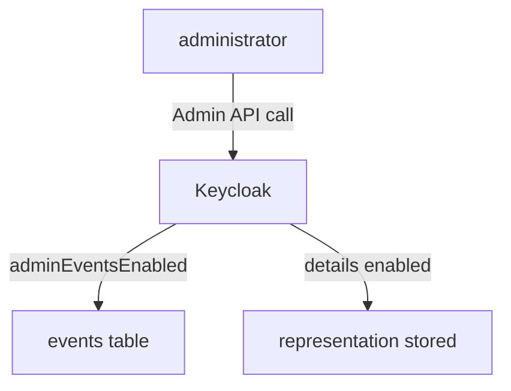

# Admin Events

User events show what users did. They do not show who gave a user a role, who disabled a client or who changed the password policy. Admin events record those changes. This part explains the two settings, what an admin event contains and how to read the changes made in a realm.

## The two settings

`adminEventsEnabled` turns admin events on. `adminEventsDetailsEnabled` also stores the **representation**, the JSON of the object as it was sent in the request, such as the body of a new user. The representation is useful and can be sensitive, because it may contain attributes and, for a password reset, other data from the request. Turn the second setting on only when the value of the audit is higher than that risk.

Admin events share the expiration of the realm's event configuration. They are written to the database when the setting is on, and they are sent to the event listeners too.

Paste the helper and enable both settings:

<!-- astrona:playground:renew -->

```sh
NAMESPACE=events-demo
kcadm() {
  kubectl -n "$NAMESPACE" exec -i deploy/keycloak -- \
    /opt/keycloak/bin/kcadm.sh "$@" --config /tmp/kcadm.config
}
kcadm config credentials --server http://localhost:8080 --realm master --user admin --password admin
kcadm update events/config -r inventory -s adminEventsEnabled=true -s adminEventsDetailsEnabled=true
kcadm get events/config -r inventory --fields adminEventsEnabled,adminEventsDetailsEnabled
```

## Making a change and finding it

Create a user and a group, then list the admin events. The kcadm call that reads them is `admin-events`:

```sh
kcadm create users -r inventory -s username=audit-sample -s enabled=true
kcadm create groups -r inventory -s name=auditors
kcadm get admin-events -r inventory -q max=5 --fields operationType,resourceType,resourcePath
```

Each event has an `operationType` (`CREATE`, `UPDATE`, `DELETE` or `ACTION`), a `resourceType` such as `USER` or `GROUP`, and a `resourcePath` such as `users/<id>`. The newest event is the group, and the one before it is the user. The `authDetails` field names who did it: the realm, the client, the user and the IP address. Here the user is the `admin` of the `master` realm.

Filters narrow the list. `operationTypes` selects the operations, `resourceTypes` selects the kinds of resource, `resourcePath` matches a path and may use `*` as a wildcard, and `authUser` selects who made the change:

```sh
kcadm get admin-events -r inventory -q operationTypes=CREATE -q resourceTypes=USER --fields resourcePath,representation
```

With details on, the `representation` field holds the JSON of the new user, including the name `audit-sample`. Without details, the field is missing.



The diagram shows that Keycloak stores an admin event for each change, and stores the request body only when the details setting is on.

You now know how to record and read the changes made in a realm. The most common use of events is to find out why something failed, which is the next part.

## Common pitfalls

> [!WARNING]
> - **Turning on details without thinking about what the body holds.** The representation can contain personal data.
> - **Expecting admin events from before they were enabled.** They are recorded from that moment.
> - **Looking for admin changes in user events.** Use `admin-events`, not `events`.
> - **Forgetting the realm.** Admin events belong to the realm that was changed, so keep `-r inventory`.
