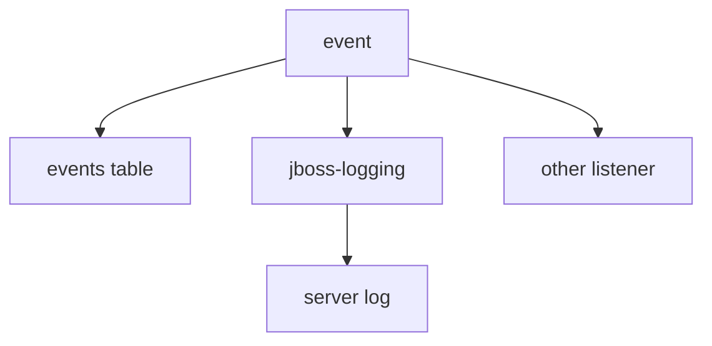

# Retention, Listeners And Server Logs

Events in the database are one destination. Keycloak also sends each event to the **event listeners** of the realm. A listener is a component that receives every event and does something with it: writes a log line, sends a message or calls another system. This part shows the listener that ships with Keycloak, where its output goes and how to keep the stored events under control.

## The jboss-logging listener

The realm field `eventsListeners` lists the listeners that receive events. The default value is `["jboss-logging"]`. The `jboss-logging` listener writes each event as one line to the server log, in the log category `org.keycloak.events`. It writes error events at the warning level and success events at the debug level, so on a default server you see failures in the log without turning events on.

Paste the helper, make a failed request and read the Keycloak log. The log line shows the event type, the realm, the client and the error:

<!-- astrona:playground:renew -->

```sh
NAMESPACE=events-demo
kcadm() {
  kubectl -n "$NAMESPACE" exec -i deploy/keycloak -- \
    /opt/keycloak/bin/kcadm.sh "$@" --config /tmp/kcadm.config
}
kcadm config credentials --server http://localhost:8080 --realm master --user admin --password admin
kubectl -n "$NAMESPACE" exec deploy/tester -- curl -s -o /dev/null \
  http://keycloak:8080/realms/inventory/protocol/openid-connect/token \
  -d grant_type=password -d client_id=inventory-cli -d username=alice -d password=wrong-password
kubectl -n "$NAMESPACE" logs deploy/keycloak --tail=200 | grep LOGIN_ERROR
```

The `grep` prints a line with `LOGIN_ERROR` and the error value. This is the same information as the stored event, in a place that log collection tools already read.

## The listeners of a realm

Read and change the list with the event configuration. Other listeners are added to a server as providers, and then their names appear in the realm settings. The email listener `email` is shipped with Keycloak and sends a message to the user for some events, for example a changed password. It needs the email settings of the realm to work:

```sh
kcadm get events/config -r inventory --fields eventsListeners
kcadm update events/config -r inventory -s 'eventsListeners=["jboss-logging","email"]'
kcadm get events/config -r inventory --fields eventsListeners
```

The list now has two entries. Removing `jboss-logging` from the list stops the log lines, so keep it unless another listener replaces it. A listener name that no provider implements is stored but receives nothing.

## Keeping stored events under control

Stored events grow with every sign-in. Two tools limit them. `eventsExpiration` deletes events older than the given number of seconds, which suits a rolling window such as one week. Clearing removes everything at once:

```sh
kcadm delete events -r inventory
kcadm delete admin-events -r inventory
kcadm get events -r inventory -q max=5
```

The last command prints an empty list. Use clearing only after an export, because an audit that is deleted cannot be recovered. For a long audit trail, send events to an external system through a listener and keep the database window short.



The diagram shows that each event goes to the database when storing is on and to every listener in the realm's list.

You now know where events go and how to keep them from growing without limit. Together with the user and admin events from the earlier parts, you can answer who did what, when it failed and why.

## Common pitfalls

> [!WARNING]
> - **Removing `jboss-logging` by accident.** Setting `eventsListeners` replaces the whole list. Include the listeners you still need.
> - **Clearing events before exporting them.** Deleted events cannot be recovered.
> - **Expecting success events in the log.** They are written at the debug level.
> - **Treating the log as long-term storage.** Pod logs rotate. Keep a copy elsewhere.
