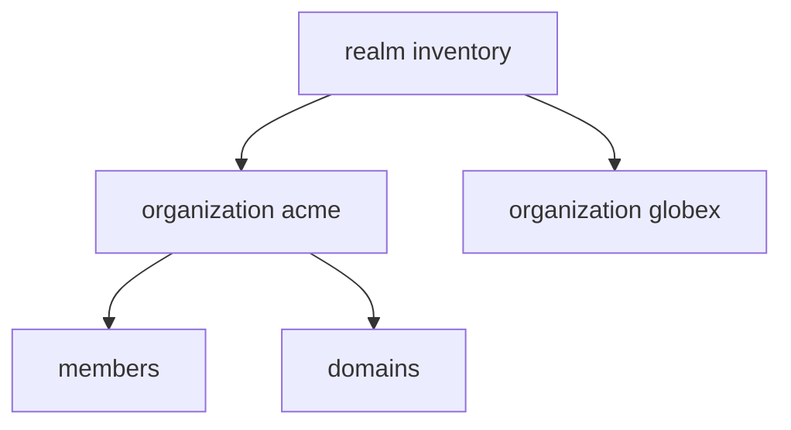

# Enabling And Creating Organizations

Organizations are a feature of a realm that an administrator turns on. Until then the realm has no organization endpoints in the Admin Console, and the organization scope has no effect. This part shows the switch, the fields of an organization and how to create one.

## The realm switch

The realm field `organizationsEnabled` turns the feature on for one realm. Other realms in the same server are not affected. Paste the helper, read the field and turn it on:

<!-- astrona:playground:renew -->

```sh
NAMESPACE=orgs-demo
kcadm() {
  kubectl -n "$NAMESPACE" exec -i deploy/keycloak -- \
    /opt/keycloak/bin/kcadm.sh "$@" --config /tmp/kcadm.config
}
kcadm config credentials --server http://localhost:8080 --realm master --user admin --password admin
kcadm get realms/inventory --fields organizationsEnabled
kcadm update realms/inventory -s organizationsEnabled=true
kcadm get realms/inventory --fields organizationsEnabled
```

The first read shows `false`. The second shows `true`.

## The fields of an organization

An organization has these fields. The **name** is a friendly name and is unique in the realm. The **alias** is the short identifier that Keycloak uses internally and in scope names, and it is unique in the realm. The alias cannot be changed after it is set, and if you leave it out Keycloak tries to use the name. Spaces, control characters and backslashes are not allowed in an alias, so use lowercase letters, digits and hyphens. The **domains** field holds zero or more email domains. The **description** is free text. The **enabled** field turns the organization off without deleting it.

Create an organization with a name and an alias, then list the organizations:

```sh
kcadm create organizations -r inventory -s name="Acme Corporation" -s alias=acme -s enabled=true
kcadm get organizations -r inventory --fields id,name,alias,enabled
```

The list shows one organization with the alias `acme`. Each organization has its own `id`, a UUID, which later calls need in the path.

## Reading and changing one organization

Save the id of the organization in a variable. The `tester` pod has `jq`, so the filter runs there:

```sh
ORG=$(kcadm get organizations -r inventory | kubectl -n "$NAMESPACE" exec -i deploy/tester -- jq -r '.[] | select(.alias=="acme") | .id')
kcadm get "organizations/$ORG" -r inventory
kcadm update "organizations/$ORG" -r inventory -s description="Customer 1"
```

The update changes the description and leaves the alias alone. To switch an organization off without losing it, set `enabled=false`. Members of a disabled organization cannot sign in to the realm through the organization, and the organization stays in the list.



The diagram shows that organizations sit inside one realm and each has its own members and domains.

You can now turn organizations on and create them. Next you give an organization an email domain, so Keycloak can match a user to it.

## Common pitfalls

> [!WARNING]
> - **Choosing an alias you want to change later.** The alias cannot be changed. Delete and recreate the organization if you need a different one.
> - **Forgetting the realm switch.** Without `organizationsEnabled=true`, the organization calls are refused.
> - **Using the name where the id is needed.** Paths use the id, not the name or the alias.
> - **Creating organizations in the `master` realm.** Create them in the realm your users sign in to.
