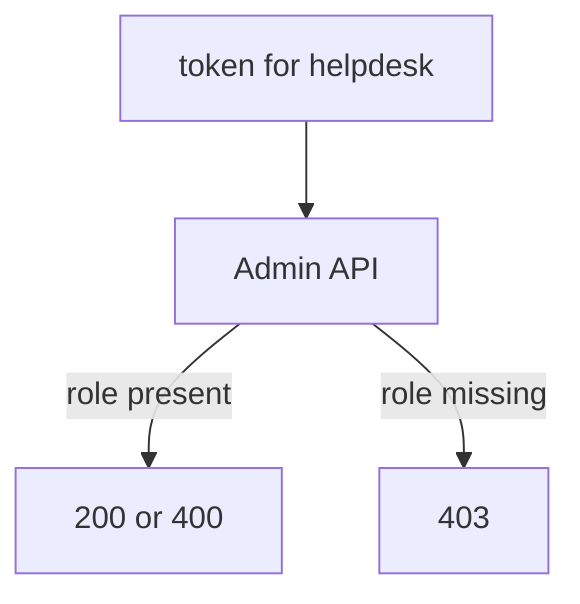

# Proving What An Administrator Can Do

A role list on a screen does not prove what an account can do. A token and a few requests do. This part shows how to sign in as the delegated administrator, call the Admin API and read the status code to tell allowed from forbidden.

## Getting an admin token

Every realm has a public client `admin-cli` with direct access grants on. Request a token for the delegated administrator from the realm `inventory`, not from the `master` realm. A helper keeps the commands short:

<!-- astrona:playground:renew -->

```sh
NAMESPACE=admin-delegation-demo
kcadm() {
  kubectl -n "$NAMESPACE" exec -i deploy/keycloak -- \
    /opt/keycloak/bin/kcadm.sh "$@" --config /tmp/kcadm.config
}
kcadm config credentials --server http://localhost:8080 --realm master --user admin --password admin
admin_token() {
  kubectl -n "$NAMESPACE" exec deploy/tester -- curl -s \
    http://keycloak:8080/realms/inventory/protocol/openid-connect/token \
    -d grant_type=password -d client_id=admin-cli -d username="$1" -d password="$1-password" \
    | kubectl -n "$NAMESPACE" exec -i deploy/tester -- jq -r '.access_token'
}
api_status() {
  # api_status USER METHOD PATH [BODY]: prints the HTTP status of an Admin API call made as USER.
  local token
  token="$(admin_token "$1")"
  kubectl -n "$NAMESPACE" exec deploy/tester -- curl -s -o /dev/null -w '%{http_code}\n' \
    -X "$2" "http://keycloak:8080/admin/realms/inventory/$3" \
    -H "Authorization: Bearer $token" -H 'Content-Type: application/json' ${4:+-d "$4"}
}
```

## Reading the status codes

Give `helpdesk` the roles of the previous part. Then call the API as that user. `GET users` is a read, and `POST users` with an empty body is a harmless write attempt: an allowed caller gets `400` because the user data is invalid, and a caller without the right gets `403` before the data is looked at.

```sh
api_status helpdesk GET users
api_status helpdesk POST users '{}'
api_status helpdesk GET events
```

The first prints `200`. The second prints `400`, which means the call was allowed and the data was wrong. The third prints `403`, because `helpdesk` holds no `view-events`. `auditor` with only `view-events` and `view-users` answers the other way:

```sh
kcadm add-roles -r inventory --uusername auditor --cclientid realm-management \
  --rolename view-events --rolename view-users
api_status auditor GET events
api_status auditor POST users '{}'
```

The first prints `200`, the second `403`.

The status `401` means the token is missing, expired or for another realm. A password for a user with no roles still gets a token, so a valid token is not a sign of rights.



The diagram shows that the Admin API decides from the roles in the token.

## Your mission: Give A Help Desk Least-Privilege Access Lab

You can now give roles and prove them with a token. The mission asks you to give the help desk and the auditor exactly the roles they need.

Pause the playground, start the lab and submit it when you are done:

```sh
astrona stop ats-089-playground-060-02
astrona run --git ssh://git@github.com/astrona-io/ATS089.git -c sections/section-060/module-02/labs/lab-01
astrona submit -c sections/section-060/module-02/labs/lab-01
```

When the lab is finished, remove it and start the playground again:

```sh
astrona destroy ats-089-lab-060-02
astrona start ats-089-playground-060-02
```

## Common pitfalls

> [!WARNING]
> - **Testing with the `master` admin.** It passes every check and proves nothing about the delegated account.
> - **Reading `400` as a failure.** For a write with empty data it means the call was allowed.
> - **Getting the token from the wrong realm.** Use the realm that holds the user.
> - **Caching a token after changing roles.** A token holds the roles of the moment it was issued. Request a new one.
